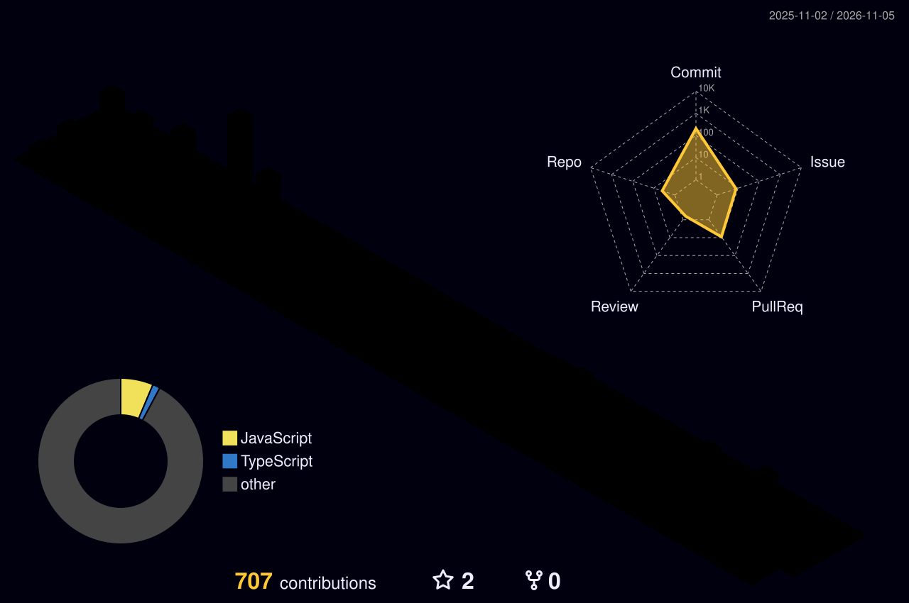

<!-- Header -->
<h1 align="center">Hi, I'm Hilton Kholokholo 👋</h1>

<p align="center">
  <a href="https://hilton-cv.vercel.app/">
    
  </a>
</p>

<p align="center">
  <a href="https://hilton-cv.vercel.app/"></a>
  <a href="mailto:damox101za@gmail.com"></a>
  
  
</p>

---

## 💡 About Me

I'm an **IT Support Technician at Xperien (Pty) Ltd** in Randburg, working across enterprise support, network infrastructure, hardware troubleshooting and secure data destruction. Outside the day job, I build software that turns real-world operational problems into practical tools.

```yaml
role:        IT Support Technician @ Xperien (Pty) Ltd
location:    Randburg, Johannesburg
education:   Higher Certificate in IT (NQF 5), Mancosa, Distinction
training:    Cisco Networking Academy (networking & cybersecurity)
day_to_day:  [UniFi, Juniper, Dell, Avaya, SFP fibre switching, isolated networks, decommissioning, data sanitisation]
open_to:     Tier 3 / Senior Technical Support, corporate & FinTech, Johannesburg
```

> *"Nothing is impossible, but everything has its limits."*

---

## 🧠 Skills

**Infrastructure and Support**

<p>
  
  
  
  
  
  
  
  
</p>

**Development**

<p>
  
</p>

**Tools**

<p>
  
</p>

---

## 🚀 Featured Projects

| Project | What it does | Stack |
|---|---|---|
| [**hilton-cv**](https://github.com/Damox101za/hilton-cv) | Personal portfolio with particle-formed name text and an animated hero | React, JavaScript |
| [**ApplesOnly**](https://github.com/Damox101za/ApplesOnly) | Personal habits, journal and goals tracker | Node.js, JavaScript |
| [**index_2.0**](https://github.com/Damox101za/index_2.0) | Reads an Excel sheet and generates one PDF per record, with header and footer images | Java |
| [**xperien_technical_support**](https://github.com/Damox101za/xperien_technical_support) | Technical support tooling | TypeScript |
| [**weeklogforXperien**](https://github.com/Damox101za/weeklogforXperien) | Weekly work-log tooling | Python |

### 🔨 Currently Building

| Project | Focus |
|---|---|
| 🧹 **WinPE data sanitisation app** | Secure wiping for device decommissioning |
| 📋 **IT asset register** | Tracking hardware across its lifecycle (Next.js) |
| 🕵️ **Anti-money-laundering detection** | Python ML models with a Next.js dashboard |

<p align="center">
  <a href="https://github.com/Damox101za?tab=repositories&sort=updated">
    
  </a>
</p>

---

## 📊 Contributions in 3D

<p align="center">
  <picture>
    <source media="(prefers-color-scheme: dark)" srcset="./profile-3d-contrib/profile-night-rainbow.svg" />
    <source media="(prefers-color-scheme: light)" srcset="./profile-3d-contrib/profile-season.svg" />
    
  </picture>
</p>

---

## 👾 Pac-Man Eats My Commits

<p align="center">
  <picture>
    <source media="(prefers-color-scheme: dark)" srcset="https://raw.githubusercontent.com/Damox101za/damox101za/output/pacman-contribution-graph-dark.svg" />
    <source media="(prefers-color-scheme: light)" srcset="https://raw.githubusercontent.com/Damox101za/damox101za/output/pacman-contribution-graph.svg" />
    
  </picture>
</p>

---

## 🌍 Connect

<p align="center">
  <a href="mailto:damox101za@gmail.com"></a>
  <a href="mailto:hiltonkholokholo@icloud.com"></a>
  <a href="https://hilton-cv.vercel.app/"></a>
</p>
